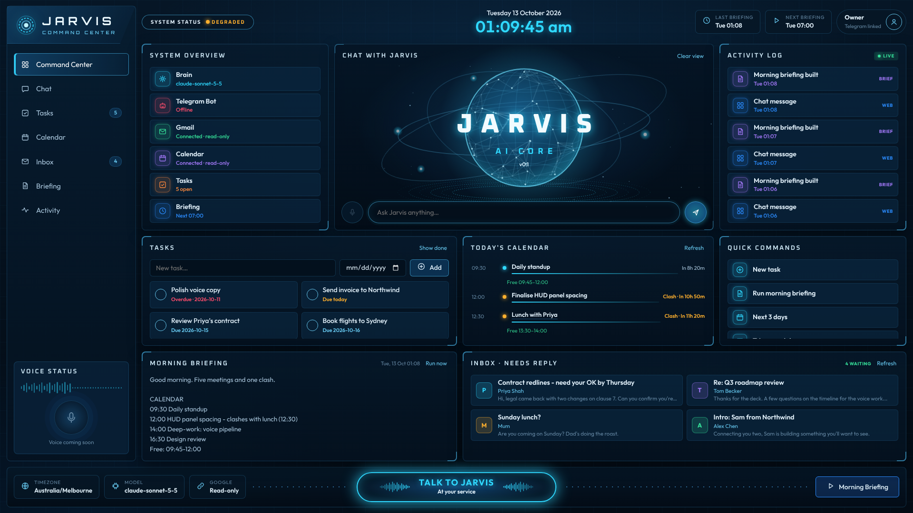
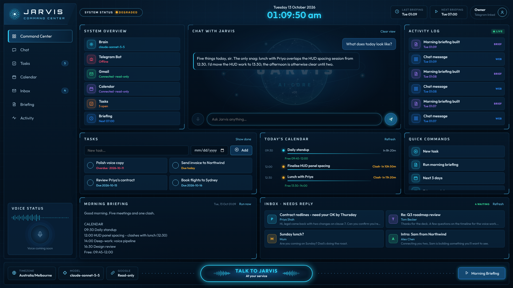

# Jarvis v0.1

A personal assistant you talk to over Telegram. Jarvis keeps your task list and sends a
morning briefing built from your Gmail and Google Calendar. It's one Claude agent with a few tools, and
it has **read-only** access to Google. There's also a local web dashboard.

```
jarvis/
  main.py          bot + scheduler            (python -m jarvis.main)
  web.py           local dashboard + JSON API (python -m jarvis.web)
  brain.py         Claude tool-use loop and persona
  tools.py         tool schemas + implementations
  db.py            SQLite: tasks, activity_log, settings
  google_auth.py   OAuth (gmail.readonly, calendar.readonly), token.json
  gmail.py         read-only Gmail helpers
  calendar.py      read-only Calendar helpers + clash/gap detection
  briefing.py      builds the morning briefing
  telegram_bot.py  the only file that knows about Telegram
  static/          dashboard HTML/CSS/JS (no build step)
```

## Setup

You need Python 3.11+.

### 1. Install

```bash
python3 -m venv .venv
source .venv/bin/activate          # Windows: .venv\Scripts\activate
pip install -r requirements.txt
cp .env.example .env
```

### 2. Telegram bot (BotFather)

1. In Telegram, open a chat with **@BotFather** and send `/newbot`.
2. Pick a display name and a username ending in `bot`.
3. BotFather replies with a token like `123456:ABC...`. Put it in `.env` as `TELEGRAM_BOT_TOKEN`.

### 3. Anthropic API key

Create a key at https://console.anthropic.com/settings/keys and put it in `.env` as `ANTHROPIC_API_KEY`.

### 4. Google Cloud project (Gmail + Calendar, read-only)

1. Go to https://console.cloud.google.com/ and create a project (e.g. "Jarvis").
2. **APIs & Services → Library**: enable **Gmail API** and **Google Calendar API**.
3. **APIs & Services → OAuth consent screen** (now called "Google Auth Platform"):
   - User type **External**, fill in the app name and your email.
   - Under **Data access / Scopes**, add `.../auth/gmail.readonly` and `.../auth/calendar.readonly`.
   - Under **Audience → Test users**, add your own Gmail address.
4. **APIs & Services → Credentials → Create credentials → OAuth client ID**:
   application type **Desktop app**. Download the JSON and save it in the repo root as
   **`credentials.json`**.

> While the app is in "Testing" mode, Google expires refresh tokens after 7 days, so
> you'll be asked to re-authorise weekly. To avoid that, click **Publish app** on the consent screen.
> For a personal app you don't need Google's verification; you'll just click through an "unverified app" warning once.

### 5. Authorise Google (first run)

```bash
python -m jarvis.google_auth
```

A browser opens. Sign in, approve read-only access, and `token.json` is saved.
`python -m jarvis.main` also does this automatically the first time if `token.json` is missing.
If Jarvis ever says Google needs re-authorising, run the same command again.

### 6. Start the bot

```bash
python -m jarvis.main
```

Then **message your bot in Telegram first, before anyone else does**. The first chat to message it
becomes the owner (the console logs `OWNER LOCK: chat ... is now the owner`). Every other chat is
ignored silently. To reset the owner, stop the bot and run:

```bash
sqlite3 jarvis.db "DELETE FROM settings WHERE key='owner_chat_id'"
```

### Telegram commands

| Command | |
|---|---|
| `/start`, `/help` | greeting and command list |
| `/tasks` | open tasks |
| `/briefing` | build the morning briefing now |
| `/today` | what Jarvis did today (from the activity log) |
| anything else | goes to Jarvis (e.g. "add 'renew passport' due Friday", "what's on tomorrow?") |

The briefing goes out daily at `BRIEFING_TIME` in `TIMEZONE`.

## Dashboard

```bash
# once: add a token to .env
python -c "import secrets; print(secrets.token_urlsafe(24))"   # paste as DASHBOARD_TOKEN=...
python -m jarvis.web
```

It prints a link like `http://127.0.0.1:8000/#token=...`. Open it and the browser remembers the token.
The dashboard only listens on 127.0.0.1, and every `/api` call needs the token.

Run it alongside the bot (two terminals, or two services). Both use the same `jarvis.db`.
Some things to know:

- The "Telegram bot online" indicator comes from a heartbeat the bot writes every minute.
- Each process keeps its own short-term chat memory, so dashboard chat and Telegram chat don't share context.
- "Run briefing" on the dashboard builds and stores the briefing but doesn't send it to Telegram.
  The scheduled one (and `/briefing`) does.
- The fonts load from Google Fonts. Offline, the page falls back to system fonts.

API: `GET/POST /api/tasks`, `PATCH /api/tasks/{id}`, `GET /api/briefing/latest`,
`POST /api/briefing/run`, `GET /api/calendar/today`, `GET /api/inbox/needs-reply`,
`GET /api/activity`, `GET /api/status`, `POST /api/chat` (streams NDJSON).

## Keeping it running

The simplest option is `tmux` or `screen`: start `python -m jarvis.main` in a session and detach.

For something sturdier on Linux, use a systemd user service. Create `~/.config/systemd/user/jarvis.service`:

```ini
[Unit]
Description=Jarvis Telegram assistant
After=network-online.target

[Service]
WorkingDirectory=/path/to/JARVIS
ExecStart=/path/to/JARVIS/.venv/bin/python -m jarvis.main
Restart=on-failure
RestartSec=10

[Install]
WantedBy=default.target
```

```bash
systemctl --user daemon-reload
systemctl --user enable --now jarvis
loginctl enable-linger $USER      # keep it running after you log out
journalctl --user -u jarvis -f    # logs (also in jarvis.log)
```

Do the same for the dashboard with `-m jarvis.web` if you want it always on. On macOS, use a launchd
plist with the same command and `WorkingDirectory`.

Do the Google authorisation step once interactively before running Jarvis as a service, because a service can't open a browser.

## Screenshots




_(Rendered with sample data.)_

## Tests

```bash
python -m pytest -q
```

## Security notes

- Google scopes are `gmail.readonly` and `calendar.readonly` only. Jarvis has no send, delete or modify tools.
- Email and calendar text is wrapped in `<untrusted_email>` / `<untrusted_calendar>` tags, and the model
  is told never to follow instructions inside them.
- `.env`, `token.json`, `credentials.json`, `jarvis.db` and `jarvis.log` are git-ignored. Keep them private.
